 

<h3>Legendary projects</h3>

<table>
<tr>
<td align="center" width="33%" valign="top">
 
<b>MedX-AI</b> 
Multilingual clinic intake 
<a href="https://github.com/KingPhuripol/MedX-AI">repo</a> · <a href="https://medx.areazeroai.com">demo</a>
</td>
<td align="center" width="33%" valign="top">
 
<b>SmartLiva</b> 
Liver ultrasound copilot 
<a href="https://github.com/KingPhuripol/SmartMed-Smartliva">repo</a>
</td>
<td align="center" width="33%" valign="top">
 
<b>SmartLab</b> 
Blood-cell quality testing 
<a href="https://github.com/KingPhuripol/SmartLab-BloodCellQualityTesting">repo</a>
</td>
</tr>
<tr>
<td align="center" width="33%" valign="top">
 
<b>NPL Early Warning</b> 
Auto-loan default radar 
<a href="https://github.com/KingPhuripol/NPL-Task">repo</a>
</td>
<td align="center" width="33%" valign="top">
 
<b>Equi</b> 
Explainable credit scoring 
<a href="https://github.com/KingPhuripol/equi-credit-assessment">repo</a>
</td>
<td align="center" width="33%" valign="top">
 
<b>ARCANUM</b> 
Thai tarot with GPT-4o 
<a href="https://github.com/KingPhuripol/TarotAI">repo</a>
</td>
</tr>
</table>

<h3>Moves I know</h3>

<h3>Trainer stats</h3>

